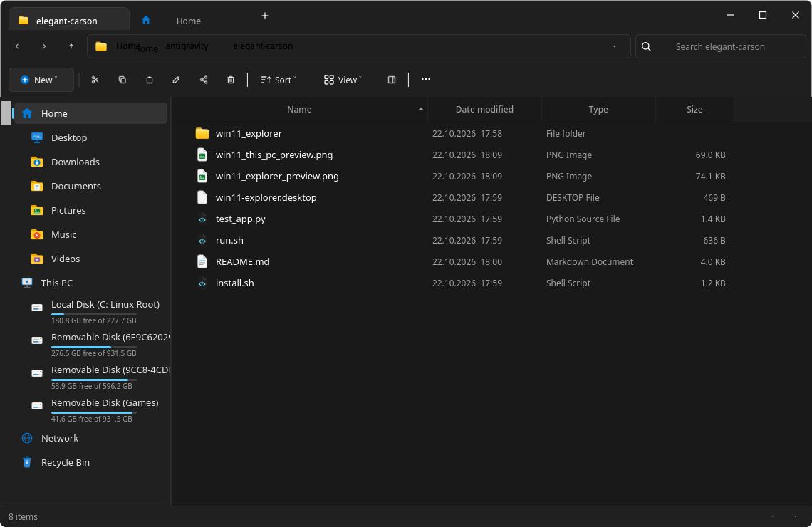
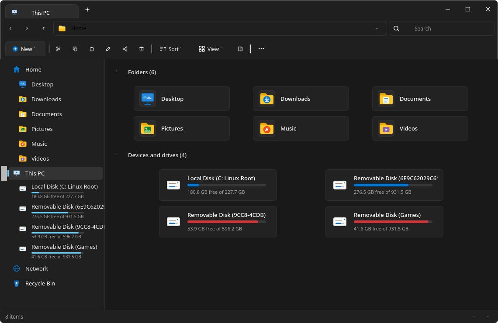

<div align="center">

# 🪟 Windows 11 File Explorer for Arch Linux

[](https://www.python.org/)
[](LICENSE)
[]()
[](https://riverbankcomputing.com/software/pyqt/)
[]()

A pixel-perfect, feature-complete **1:1 replica of the modern Windows 11 File Explorer** (22H2 / 23H2 / 24H2) built natively for **Arch Linux**, **CachyOS**, and other Linux distributions using Python and **PyQt6**.

[Features](#-features) • [Screenshots](#-screenshots) • [Installation](#-installation) • [Shortcuts](#-keyboard-shortcuts) • [Architecture](#-project-structure)

<br/>



<p align="center"><i>Windows 11 Explorer running natively on Arch Linux (KDE Plasma / Wayland)</i></p>

</div>

---

## 📸 Screenshots

| Standard Files View | "This PC" Drives & Devices View |
|:---:|:---:|
|  |  |

---

## ✨ Features

- **🪟 Authentic Windows 11 Titlebar & Tabs**:
  - Tabs integrated directly into the top window bar (no double titlebar!).
  - Multi-tab management: Add tabs (`+` / `Ctrl+T`), close tabs (`✕` / `Ctrl+W`), with individual folder history per tab.
  - Native caption buttons: Minimize (`─`), Maximize/Restore (`□` / `❐`), and Close (`✕` with red hover highlight).
  - Native Wayland & X11 dragging (`startSystemMove`) and edge resizing (`startSystemResize`).

- **🧭 Interactive Breadcrumb Address Bar**:
  - Clickable folder segments (`Home > apex > Documents > Projects`).
  - Chevron dropdown menus (`>`) to quickly navigate sibling/child directories.
  - In-place path editor with instant UNIX path entry and `Enter` navigation (`Ctrl+L` / `Alt+D`).
  - Integrated refresh button (`F5`).

- **🔍 Windows 11 Search Bar**:
  - Dynamic folder-aware placeholder (`Search <FolderName>`).
  - Real-time live filtering and quick clear (`✕`).

- **🎛️ Fluent Command Bar (Ribbon)**:
  - `+ New` dropdown (Folder, Text Document, Terminal).
  - Action buttons: Cut (`Ctrl+X`), Copy (`Ctrl+C`), Paste (`Ctrl+V`), Rename (`F2`), Share, Delete (`Del`).
  - `Sort` dropdown (Name, Date modified, Type, Size; Ascending / Descending).
  - `View` dropdown (Large icons, Medium icons, Small icons, List, Details, Tiles, Hidden items).
  - `Details pane` toggle button (`Alt+Shift+P`).
  - `...` (More) menu with Terminal launcher, path copy, theme switch, and properties.

- **💻 "This PC" Dedicated View**:
  - **Folders group**: Desktop, Downloads, Documents, Pictures, Music, Videos.
  - **Devices and drives group**: Root drive (`/`), Home drive (`/home`), and external removable media with **genuine live capacity progress bars** (blue gauge, red when >90% full, and free space metrics).

- **📑 Windows 11 Details Pane**:
  - Collapsible right-hand sidebar showing large file previews, MIME types, file sizes, timestamps, and full file path.

- **📋 Modern Floating Context Menu**:
  - Horizontal quick-action bar at the top (Cut, Copy, Rename, Share, Delete).
  - Standard file operations: Open, Open in Terminal, Copy as path, Properties.

- **ℹ️ Windows Properties Dialog**:
  - Authentic Properties window featuring General metadata (size, size on disk, timestamps, attributes) and Security (Linux permissions & ownership).

- **🎨 Themes**:
  - Windows 11 Dark Mode (Mica) and Light Mode with dynamic runtime toggle.

---

## 🚀 Installation

### Option 1: Arch Linux (PKGBUILD / AUR)

```bash
git clone https://github.com/Lucy134645/win11-explorer.git
cd win11-explorer
makepkg -si
```

### Option 2: One-Click User Install (`~/.local/bin` & App Menu)

```bash
git clone https://github.com/Lucy134645/win11-explorer.git
cd win11-explorer
./install.sh
```
This links the launcher into `~/.local/bin/win11-explorer` and registers the `.desktop` file so it appears in your application launcher (KDE, GNOME, Rofi, etc.).

### Option 3: Python Package (`pip install .`)

```bash
git clone https://github.com/Lucy134645/win11-explorer.git
cd win11-explorer
python3 -m venv .venv
source .venv/bin/activate
pip install -e .
win11-explorer
```

### Option 4: Standalone Runner

```bash
./run.sh
```

---

## ⌨️ Keyboard Shortcuts

| Shortcut | Description |
| :--- | :--- |
| `Ctrl + T` | Open new tab |
| `Ctrl + W` | Close current tab |
| `Ctrl + N` | Open new window |
| `Ctrl + Shift + N` | Create new folder |
| `F2` | Rename selected file or folder |
| `Del` | Move selected items to Recycle Bin |
| `F5` / `Ctrl + R` | Refresh directory |
| `Alt + Up` | Go up one directory |
| `Alt + Left` | Navigate back in history |
| `Alt + Right` | Navigate forward in history |
| `Ctrl + L` / `Alt + D` | Focus and edit address bar |
| `Ctrl + F` | Focus search bar |
| `Ctrl + H` | Toggle hidden files (`.dotfiles`) |
| `Alt + Shift + P` | Toggle right-hand Details Pane |
| `Ctrl + A` | Select all items |
| `Alt + Enter` | Open Properties dialog |

---

## 📁 Project Structure

```
win11-explorer/
├── assets/                          # Screenshot previews for GitHub
│   ├── preview_main.png
│   └── preview_this_pc.png
├── win11_explorer/                  # Main Python package
│   ├── __init__.py
│   ├── main.py                      # Application entry point & CLI parser
│   ├── main_window.py               # Main window container & frame handlers
│   ├── icons.py                     # Vector SVG Fluent 2 icon engine
│   ├── styles.py                    # Mica dark & light Qt stylesheets
│   ├── models.py                    # Qt File system item & table models
│   ├── file_ops.py                  # File operations, clipboard, trash & drives
│   ├── resources/                   # Desktop icon assets
│   └── widgets/
│       ├── titlebar.py              # Win11 integrated tabs & caption controls
│       ├── tab_bar.py               # Tab bar with '+' button
│       ├── nav_bar.py               # Back, Forward, Breadcrumbs & Search
│       ├── breadcrumb.py            # Clickable path pills & chevron menus
│       ├── command_bar.py           # Ribbon bar with action buttons
│       ├── sidebar.py               # Left navigation tree with accent indicators
│       ├── this_pc_view.py          # This PC drive tiles & progress bars
│       ├── file_view.py             # Details table & grid views with checkboxes
│       ├── details_pane.py          # Right metadata preview pane
│       ├── context_menu.py          # Modern Win11 rounded context menu
│       ├── properties_dialog.py     # File properties dialog
│       └── status_bar.py            # Bottom status bar
├── .github/
│   ├── workflows/ci.yml             # Automated CI workflow
│   └── ISSUE_TEMPLATE/              # Bug & feature templates
├── PKGBUILD                         # Arch Linux package build recipe
├── pyproject.toml                   # Modern Python packaging configuration
├── requirements.txt                 # Dependencies
├── install.sh                       # One-click desktop installer
├── run.sh                           # Self-contained launcher script
├── win11-explorer.desktop           # Freedesktop application entry
├── CONTRIBUTING.md                  # Contribution guidelines
├── LICENSE                          # MIT License
└── README.md                        # Documentation
```

---

## 🛠️ Requirements

- **Linux**: Arch Linux, CachyOS, Manjaro, EndeavourOS, Fedora, Ubuntu, Debian, etc.
- **Python**: `>= 3.9`
- **Qt Toolkit**: `PyQt6 >= 6.5.0`
- **Trash Utility**: `send2trash >= 1.8.0`

---

## 🤝 Contributing

Contributions, bug reports, and suggestions are welcome! Please check out [CONTRIBUTING.md](CONTRIBUTING.md) to get started.

---

## 📄 License

This project is licensed under the [MIT License](LICENSE).
